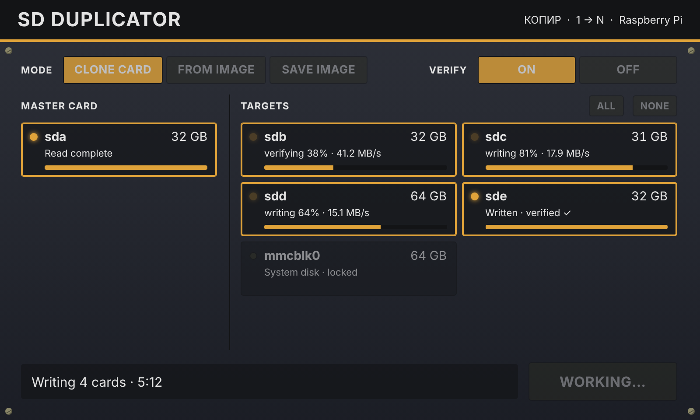

# sdmult: one SD card in, many SD cards out

`sdmult` copies a master SD / microSD card to an image file, then writes that
image to every target card plugged into the Pi at the same time, and reads each
card back to prove it matches. It is a single Python 3 file with no extra
packages, so it runs on stock Raspberry Pi OS.



## Install on the Pi

```bash
git clone https://github.com/mbreilly/sd_multiplier ~/sd_multiplier
cd ~/sd_multiplier && sudo ./install.sh
```

This installs to `/opt/sdmult`, starts the GUI as a background service
(`sdmult-gui`, listening only on `localhost:8765`), and adds **SD Duplicator**
to the app menu. It prints the full link, including the access key. To update
later: `git pull && sudo ./install.sh`. To remove: `sudo ./install.sh --remove`.

## GUI

Pick a mode (Clone card, From image, Save image), tap the master card, tap the
targets (or ALL), press Write. A confirmation lists exactly which cards will be
erased. Each card then shows its own progress bar and ends as "verified ✓" or
"FAILED" with the reason. The system disk is shown as locked. The page fits the
800×480 Pi touchscreen and scales to any window.

To reach it from a laptop or phone, run it on the LAN instead:
`sudo sdmult-gui --host 0.0.0.0` (anyone needs the printed key to use it).
Colours can be tuned with `ui-designer/sdmult-colors.html`; after editing
`sdmult_gui.html`, rebuild the designer with `python3 ui-designer/build_designer.py`.

Plug the master card and the blank cards in through USB card readers (a powered
USB hub is strongly recommended once you go past two readers).

## Everyday use

```bash
sudo sdmult list                                   # see what is plugged in
sudo sdmult clone /dev/sda --targets auto          # master in sda -> every other card
sudo sdmult clone /dev/sda /dev/sdb /dev/sdc       # or name the targets yourself
```

Keep the master image so you can make more batches later without the master card:

```bash
sudo sdmult read  /dev/sda -o ~/master.img         # once
sudo sdmult write ~/master.img --targets auto      # each batch
```

`sdmult list` marks each disk as `PROTECTED (system)`, `card / usb`, or
`fixed disk`. Before anything is written you see the exact list of cards that
will be erased and must type `yes` (or pass `--yes` for unattended use).

When it finishes it prints how many cards were written and verified, and names
any card that failed with the reason. Exit code is 0 when all cards passed,
2 if any failed, 1 if the job was refused before writing.

## Safety rules (always on)

* The disk the Pi is running from (`/`, `/boot`, `/boot/firmware`, swap) is never
  written. This is detected two ways: by mount points and by the device number
  behind `/`, so it holds even if you boot from a USB SSD.
* The source card is never a target, and targets are checked **before** the
  source is read, so a mistake is caught in seconds, not after a long read.
* Targets must be whole disks (`/dev/sdb`, not `/dev/sdb1`), removable/USB/SD,
  writable, and big enough. Internal disks need `--allow-fixed`.
* Targets' partitions are unmounted, then the disk is opened exclusively; if
  something else still holds it, that card fails instead of being half-written
  under a running program.
* Each card is read back with the page cache bypassed and its SHA-256 compared
  to the image. A bad card is reported; the others carry on.

## Card size differences

Two "32 GB" cards are rarely exactly the same size. For normal Raspberry Pi
OS cards (MBR partition table) `sdmult` only copies up to the end of the last
partition, so a slightly smaller target still works and the copy is faster.
Raspberry Pi OS grows the root partition to fill the card on first boot. Use
`--full` to copy every byte. GPT cards are always copied in full.

## Options

| option | meaning |
|---|---|
| `--targets auto` | every removable card except the source and the system disk |
| `--yes` | skip the typed confirmation |
| `--no-verify` | skip read-back (faster, not recommended) |
| `--full` | copy the whole source card, not just its partitions |
| `--image PATH` / `--keep-image` | (clone) where to keep the master image; otherwise a temp file in `/var/tmp` is deleted afterwards |
| `--allow-fixed` | allow non-removable targets (dangerous) |

## Speed

All cards are written in parallel, so the limit is usually the USB bus: a Pi 4
or 5 with a USB 3 hub and USB 3 readers is much faster than a Pi 3 (where
every port shares one USB 2 link). Verification roughly doubles the total time
and is worth it. The master image needs free space equal to the used part of
the card; put it on a USB drive with `--image` if the Pi's own card is small.

## Testing

```bash
python3 -m unittest -v test_sdmult      # no root or cards needed
```

The tests cover the safety checks (boot disk, source, partitions, size,
duplicates, fixed disks), parallel write + verify, and detection of a
corrupted card. The full CLI was also run against loop devices, including a
mounted target, a too-small target and the system disk.

## Not done yet

* Compressed images (`.img.xz` from the Raspberry Pi Imager download): decompress first with `xz -dk file.img.xz`.
* A "station" mode that writes each card automatically as soon as it is plugged in.
